# Current Roadmap

Language policy: the game, resident names, dialogue, Kimi/GM instructions and this roadmap use English. Conversation with the user stays Chinese. Original archived evidence is retained without rewriting what was said.

Current milestone: a recoverable ten-resident / ten-GM loop. Bounded live participation and bread adoption were recorded upstream. Local offline workflow checks pass, but sustained unattended autonomy, long-term food supply and natural ration sharing remain unproven.

The active lineage is `shared:restart-20260918-01`, now saved at seq266 with the complete ten-resident history and 245 world usage records under [worlds/](worlds/README.md). Original seq450 and its separate local seq452 continuation remain unchanged. H117, H119, H120, H121, H122, H123 and H124 resumed real resident calls under authorized supplemental accounting, conservatively retaining every old liability and unknown. The missing provider ledger is not claimed recovered. On September 19–20, 86 additional Kimi calls settled for CNY 1.8116122 after the earlier baseline; Rowan adopted self-repair and now made a real 2 Col edge-repair offer, Iris acted on terminal resource feedback and later recovered finite iron, and Smith discovered and recovered iron before answering Rowan's work conversation. GM04 completed one measured new-epoch effect review, with separate unpriced token usage. The 15-minute engineering heartbeat remains active; live episodes stay bounded and credentials remain local.

The active lineage has since advanced to seq266 with 245 world usage records and CNY 2.0622152 of additional Kimi cost after the earlier baseline. H126's 12 calls settled with no unknowns; its 600-second capture resolved and drained internally, but the outer runner timed out while closing. H130 formally settled the pre-existing Carpenter command in a verified physics-only continuation, H131 recorded Smith answering Carpenter willing, and H133 recorded Rowan's real 2 Col repair offer. The public checkpoint and exact cold restore now reach seq266. Flint's acceptance, escrow, physical delivery, edge repair and sustainable resources remain open.

## Current work

- **User-authorized GitHub snapshot (2026-10-08):** publish current local source, original assets, review evidence and visible-message history on `codex/publish-local-20261008`. Preserve `main`, user saves and private build/account material. See [publication scope](docs/publication-20261008/README.md); remote verification, not this preparation note, establishes delivery.

- **Preview cleanup (2026-10-08):** on user request, ten obsolete/duplicate
  browser tabs and eight old game-preview services8787–8794 were closed.
  Preserve current gallery8786 and final castle game8795; all artifact files
  remain. Historical game URLs below are recoverable but no longer running.
  The separate active project remains. The user subsequently stopped the Apple monitor.

- **Gate Siege squad campaign (2026-10-08):** version0.3.1 adds the second
  reference's scrolling +1 recruitment and whole-squad upgrades,36 persistent
  individually firing soldiers, eight waves and five distinct weapons. Articulated
  dragons, armored golems and six-legged skitters join the moving brutes.
  Two requested auditors drive staged visual and gameplay repairs; final crowded
  frames retain colored projectiles, legible multipliers and grounded shadows.
  Low/Auto retain a1280px portrait3D long axis with batching and bounded effects.
  The user authorizes fake bullets: deterministic32-cell/10Hz coverage now
  handles damage and the GPU animates decorative trails. Same-fixture desktop
  CPU means fall43–73%; source and isolated-package197 checks pass. Preview8810 and
  its exact-package review gallery are the delivery surface. Sustained phone30FPS
  and pixel identity remain unproven. Hole Feast and resident worlds stay
  separate; no Git publication. Earlier0.2.x evidence remains historical.
  [Gate Siege handoff](experiments/gate-siege/docs/CONTINUE.md).

- **Royal castle map rebuilt (2026-10-08):** five original Blender families
  replace the simple third-map architecture with tiered keeps, unequal towers,
  layered roofs and real portals/windows. Revised grounds and sixteen edible
  garden props give the palace courts depth; Frost physics are explicitly
  frozen to the prior geometry. Two reviewers accept models, real GPU play,
  installed cards and final exact-package evidence. Source/PCK each pass98
  suites (176,870/176,860 checks); 1,342 inputs and18 exports match. Two ordinary
  ninety-second desktop runs and fresh browser movement/collection pass.
  Preview8795 and a before/after/video gallery are ready; real saves, conversion,
  native build34 and earlier previews remain. Phone performance is unmeasured.
  [Castle handoff](experiments/hole-city/docs/royal-castle-20261008/CONTINUE.md).

- **Closer map-selection screenshots (2026-10-08):** four real-world images
  now feature thematic streetfronts and people, pastry towers, castle guards,
  and a penguin/ice group. Both reviewers accept the close compositions and
  actual responsive cards. Only four static PNGs and their capture helper
  change; GPU574 and focused source/exact-PCK653 checks per phase pass.
  New local preview8794 and a before/after gallery are ready. Real saves and
  submitted native build34 remain unchanged.
  [Thumbnail handoff](experiments/hole-city/docs/map-thumbnails-close-20261008/CONTINUE.md).

- **Case reveal celebration (2026-10-08):** NEW SKIN now gets a brief
  rarity-colored comet/star burst behind its live model. Natural completion and
  SKIP trigger once; currency and saved results remain unchanged. Two reviewers
  accept the final continuous capture after an observed triangulation error is
  fixed. GPU UI 712 checks and focused source/exact-PCK 1,123 checks per phase
  pass. A muted video and verified separate Web preview at 8793 are ready.
  Native build 34 and all user saves remain; phone performance is unmeasured.
  [Celebration handoff](experiments/hole-city/docs/case-celebration-20261008/CONTINUE.md).

- **Distinct map, menu and case music (2026-10-08):** all four worlds now have
  separate CC0 recordings, menus retain their own bossa theme, and cases gain
  an original score plus a timed 4.25-second anticipation cue. One streamed
  voice handles fades, bookmarks, independent preferences and rewarded-ad
  suspension. Two GPT-6 Astra / ultra reviewers accept scene-fit, licenses,
  signal/runtime evidence and the final package. Source and exact Web export
  each pass 97 suites / 176,645 checks; 1,332 inputs and 18 export hashes match.
  A 45.35-second real Mac mixer/intro/case capture and six-track audition gallery
  are ready. Browser startup at 8792 is verified. Subjective audition and phone
  output are not certified; submitted build 34 and actual saves remain unchanged.
  [Music handoff](experiments/hole-city/docs/music-worlds-20261008/CONTINUE.md).

- **Animated skin cases (2026-10-08):** skin acquisition now routes through
  HOLES → OPEN CASE, with actual-model thumbnails, a decelerating reel, six rarity
  tiers, original sound cues, SKIP and explicit equip. One100-coin opening commits
  one unowned skin and its recoverable receipt before animation. Existing odds,
  guarantees, recharge/exchange and all200 skins remain. Repeated CONTINUE taps
  cannot charge the next case. Final GPU interaction647checks pass; source and
  exact Web package each pass96suites /176,455checks with1,318 unchanged inputs.
  Final browser startup at8791 is verified; a9.42s real desktop clip and review
  gallery are ready. Phone performance and native upload remain outside this
  local iteration; real saves and submitted build34 are preserved.
  [Case handoff](experiments/hole-city/docs/case-opening-20261008/CONTINUE.md).

- **Horizontal world selection and sequential unlocks (2026-10-08):** HOME now
  presents all four playable worlds as one swipeable row of real screenshot
  cards, with locked previews and concise progress. City is open; completing a
  positive-score City round unlocks Food; completed Food 200 unlocks Toys;
  completed Toys 300 unlocks Frost. Versioned entitlements preserve played
  legacy worlds, currency, skins and saves. Two reviewers accept the layout
  and final interaction path. Final GPU checks pass 561; source and exact Web
  package each pass 93 suites / 175,537 checks with 893 unchanged guarded inputs.
  New local preview is at 8790. Browser swipe, locked launch rejection and City
  launch/movement and natural completion-to-Food unlock are verified.
  Phone validation and a new native build remain
  outside this local change; submitted build 34 is preserved.
  [Map selection handoff](experiments/hole-city/docs/map-carousel-20261008/CONTINUE.md).

- **Glacier map rebuilt and independently accepted (2026-10-08):** two requested
  reviewers reject the inherited cone/grid look and the first box-like rebuild,
  then accept the revised real gameplay and model evidence. Six original Blender
  ice families, attached snow, irregular frozen leads, polar actor visuals and
  16 edible glacier shoulders replace the old presentation. Focused geometry and
  collection checks pass 2,487 assertions. Two ordinary 90-second desktop rounds
  reach levels 7 and 8; a muted full-round video and comparison gallery are ready.
  The final source and exact Web package each pass 93 suites / 175,836 checks,
  with 881 unchanged guarded inputs. Browser selection, launch and movement are
  verified at 8789. Phone performance is unmeasured; native build 34, other maps,
  real saves, score economy and all 200 skins remain.
  [Glacier handoff](experiments/hole-city/docs/glacier-frozen-review-20261007/CONTINUE.md).

- **200-skin collection implemented locally (2026-10-07):** the user now permits
  palette variants and delegates grading. The runtime contains40 Common /
  60 Uncommon /48 Rare /28 Epic /16 Legendary /8 Prismatic entries across68
  named base families, including eight new modeled assemblies. All first60 IDs
  and ownership remain; rarity changes are intentional. Every skin has actual
  player/collection geometry and pooled item/rival feedback. Final independent
  art review accepts the repaired200-entry render set with stated detail/HUD
  limits. Two normal40-second Mac gameplay clips and a filterable400-image
  gallery are available locally. Focused GPU2,996, weather791, collection1,680
  and UI71,619checks pass. Final source/package gates each pass92suites/
  173,349checks; exactPCK GPU2,996 and weather791 pass.
  The verified200 preview renders at8788. Submitted34 remains.
  [Current production handoff](experiments/hole-city/docs/skin-production-200-20261007/CONTINUE.md).
  The earlier60-skin checkpoint and superseded art allocation remain historical
  in [the original plan](experiments/hole-city/docs/skin-collection-200-20261007/PLAN.md).

- **Prismatic weather skins, local development (2026-10-07):** Tempest and
  Rainfall keep their IDs and move to highest Tier 6. Violet/gold Tempest has
  restrained electrical accents; Rainfall gains clear jade water, pearl clouds
  and an opal rim. Independent visual review rejects the first muddy green pass
  and accepts the refinement. Both reviewers inspect actual render/UI evidence.
  Eight focused suites / 3,466 checks pass, including cold saves and preserved
  single-entry physics timing. Matched two-skin draws stay 6/7/11 for idle/object/
  rival; phone frame rate is unmeasured. A muted 14-second Mac video and actual
  highest-tier collection screenshots are delivered. Two further40-second normal
  full-map/HUD gameplay videos record23objects and one rival each, with no game
  source changes. Submitted34 and user saves
  remain; no native/Web export or publication.
  [Handoff](experiments/hole-city/docs/weather-prismatic-20261007/CONTINUE.md).

- **Hole Feast review submitted (2026-10-07):** version0.13.0/build34 and the
  100/360/1800diamond products were formally submitted at12:40Shanghai; all four
  items are Waiting for Review under842ccbb6-e210-418f-b71d-907124dbf42d.
  TestFlight Owner Testing34is enabled. The user's original phone recording
  imports through AirDrop and ends971points/97coins; a labelled physical-device
  launch/gameplay/Sandbox video and all seven requested Notes are attached.
  Notes disclose phone32versus34numeric differences. Economy is100coins/draw,
  100diamonds→2000coins,2diamond options, unchanged score/10. Current44skins remain;
  future200catalog is a tested planning assumption. Source/exactPCK9469checks each
  plus focused follow-ups pass. Await Apple's decision; manual release is pending.
  Old removed review conversation has no Reply control; no separate message is
  claimed sent. No Git publication or phone34installation.
  [Current handoff](experiments/hole-city/docs/review-resubmission-20261007/CONTINUE.md).

- **Hole Feast score-based economy (2026-10-05, latest user correction):**
  confirmed ratio is1,000points=100coins, with no minimum or finish bonus.
  The imported real Toy Town recording ends963points, so the new reward is96
  coins or144with the optional multiplier. Source/HUD/support and isolated
  economy checks pass; source/Web each pass91suites/71,320checks. Actual muted
  Mac GPU captures show96/144coins and the preview runs at8779. Native31 passes
  strict Development/Distribution signatures and23fresh suites/23,574checks.
  Xcode successfully uploads31 at11:52:53Shanghai; Apple processing has started.
  The original local success-marker parsing failure is independently reconciled;
  do not re-upload31. Restore Chrome Apple login, verify processing and add31 to
  the existing Owner Testing group (one account-holder tester, zero builds).
  Existing saves/30 remain; no phone or App Review submission occurs.
  [Current handoff](experiments/hole-city/docs/score-coins-20261005/CONTINUE.md).

- **Hole Feast Apple information response (2026-10-05, release resumed):**
  build30 is already uploaded and now actually installed on iPhone16ProMax;
  all44 Documents files are identical before/after the same-bundle update.
  After explicit current-agreement approval, Finder downloads iOS27.0.1 but its
  full-device backup fails for insufficient Mac space. User-authorized cleanup
  then reclaims45.5GB. The user's later update is verified as27.2 Beta; build30
  launches normally and a fresh44-file backup succeeds. Native recording is
  unsupported and QuickTime fails; the user is asked to record on the phone.
  Chrome login is restored,30 processing is verified,30 is saved as the review
  build, and corrected three-world store copy is saved. The new100-diamond SKU
  is created with US$1.99 pricing and English metadata; final readback, review
  screenshot and Sandbox verification remain. Seven-item reply and concise
  Notes are corrected to the three worlds, exact50coins and100-diamond entrySKU.
  Actual current-OS recording,100SKU/liveSandbox and review submission
  remain pending. No source change or repeated full gate.
  [Current release handoff](experiments/hole-city/docs/review-resubmission-20261005/CONTINUE.md).

- **Hole Feast remote TestFlight (2026-10-05, authorized continuation):**
  native30 has actual Development archive/signature and23fresh suites/23,560checks.
  Distribution export02 officially succeeds and its real IPA is verified.
  CLI upload01 times out; the later Organizer attempt signs but fails at rsync
  packaging. The deliberate second CLI attempt fixes its child environment and
  officially uploads30 on October5 at00:25:45 Asia/Shanghai. Apple's success and
  processing-started messages are verified; all game/app/symbol bytes remain
  unchanged. No upload process remains and30 must not be re-uploaded. Restore
  Apple web login, verify processing completion and enable the existing account
  owner's internal tester. Download availability is not yet verified.
  [TestFlight handoff](experiments/hole-city/docs/fairytale-city-20261004/testflight-30.md).

- **Hole Feast modular castle city and exact one-draw economy (2026-10-04):**
  latest local candidate supersedes the October3 coin range and stone/toy art.
  Five original Blender block buildings, glossy plastic and a5–38m skyline are
  playable at8777, with actual art/game images at8778. Normal completed rounds
  give exactly50coins; one draw50, optionalboost75;100diamonds exchange250coins.
  Source and Web-PCK each pass91suites/71,306checks with838 unchangedinputs.
  Actual90-second Mac play collects two castles/six houses and saves50coins.
  The planned USD1.99 product still needs Apple configuration after login;
  fresh native30 acceptance passes; device/Sandbox acceptance and Apple2.1
  evidence remain before App Review. Existing saves/builds and paused automations
  are preserved.
  [Current handoff](experiments/hole-city/docs/fairytale-city-20261004/CONTINUE.md).

- **Bubble Toy Town and combined release (2026-10-03, active direct request):**
  the user explicitly stops the five-hour scheduled task; its automation is
  PAUSED and the owned awake helper is terminated. The original0.13.0 map
  passes90fresh source and90fresh Web-PCK suites,71,202checks per phase with824
  unchangedinputs. Two ordinary90-second Mac runs each collect two wholepalaces,
  ending306/333points; cold and late desktop spikes remain. The prior0.12.7
  preview and rejectedbuild26 stay unchanged. Newthree-world preview is8775.
  [Map handoff](experiments/hole-city/docs/toy-city-20261003/CONTINUE.md).

- **Hole Feast Apple2.1 combined response and coin correction (2026-10-03, active):**
  direct combined release authorization remains active. Native 0.13.0/build 27
  passes 21 fresh native-PCK suites and is actually Development-installed, with
  an identical save before/after installation and a successful ordinary launch.
  Distribution export 27 times out at signing, so no new IPA/upload is claimed.
  The user then requests at least 50 coins and one draw per normal round. The
  new finish bonus is 50, with up to 30 score coins; draws stay 50 at every level.
  Twelve focused suites pass 11,876 checks. Fresh gate 02 passes 90 source and 90 packaged suites, 71,221 checks each;
  its accepted preview is 8776. Build 28 compiles/links but its Development
  archive times out at codesign after 900 seconds; the exact owned signer is
  cleaned up. No native28/PCK/installation success is claimed. Recovery29 is
  prepared and independently reviewed, awaiting current human signing availability.
  Ordinary Mac City/Food/Toy rounds actually award56/52/53coins and each supports
  a50coin draw. V6-03/04 first-image failures remain; recording-only05 fixes the
  image wait and captures all four masters. Its Sushi clear-train framing fails,
  so no complete new store-media export is claimed. The last known phone OS is
  26.7.1/23H30; Apple lists 27.0.1 as latest, and its connection is subsequently
  unavailable. Major upgrade, current physical launch/paid-feature recording
  and a human-created Sandbox tester remain required. No Git publication,
  new legalagreement, banking/taxaction or fabricatedpurchase is authorized.
  [Release handoff](experiments/hole-city/docs/release-completion-20261003/CONTINUE.md).

- **Hole Feast authorized US release execution (2026-10-03):** production25
  compiles the current food icon and unchanged 0.12.7 game, then stops at blocked
  codesign after 900 seconds. Exact outputs and owned-process cancellation are
  retained; there is no successful current IPA, installation, upload or review
  submission. Direct Apple sign-in and local security-window authorization are
  required. Three diamond metadata sets and seven-category privacy drafts are
  prepared; actual account inspection finds default AdMob mediation and an
  unpublished US privacy message. Tracking, sandbox acceptance and fresh bank/
  tax status remain open. Support Site v6 is successfully published with the
  food icon, corrected advertising disclosure and 1.5x reward wording. Existing
  media, saves, previews and failures are preserved; no heavy worker or root
  GitHub publication remains. [Current handoff](experiments/hole-city/docs/release-completion-20261003/CONTINUE.md).

- **Hole Feast publication recheck (2026-10-03):** there is still no signed
  current food-icon package or upload/submission receipt. Native24 remains an
  unsigned icon project; V5 media is ready locally. Actual Apple Business refresh
  redirects to failed authentication. Current bank/tax and diamond account state
  needs a fresh login; historical incomplete states are not promoted to current
  observations. No heavy job, device or account mutation is started for this
  check. [Current handoff](experiments/hole-city/docs/app-icon-food-20261002/CONTINUE.md).

- **Hole Feast food-swallowing icon (2026-10-02):** the new original opaque
  1024-square app icon shows sushi entering a black hole, with croissant and
  strawberry falling in. The native helper selects and independently binds it;
  unsigned build24 verifies all16 AppIcon sizes. Gameplay's810 inputs stay frozen.
  Review V5 at8774/store-review-v5/index.html uses the new branding and exact V4
  five screenshots/two videos. Previous production23 stops at codesign timeout,
  with output preserved. No new signature, phone installation or upload exists.
  [Icon handoff](experiments/hole-city/docs/app-icon-food-20261002/CONTINUE.md).

- **Hole Feast current release readiness (2026-10-02):** accepted0.12.7/V4
  remain frozen. Production23 compiles and links, with archive signing waiting
  for the user's local keychain action; there is no successful current export,
  device installation, upload or submission. ASC requires renewed login.
  Previous bank/tax prerequisites, final diamond metadata/sandbox acceptance and
  accurate privacy declarations remain open. Exact product/review fields are
  prepared locally. US-only release scope and latest phone saves are preserved.
  [Current release handoff](experiments/hole-city/docs/collapse-surface-20261002/CONTINUE.md).

- **Hole Feast building cut-surface correction (2026-10-02):** the user
  rejects V3's actual building appearance. Accepted 0.12.7 retains the whole
  actual instantiated building during physical support loss and uses uniform
  whole-building occlusion fade. Localized exposed rear faces and open facade
  grid fragments are removed from runtime. Former 48-point totals wait for
  complete collection; real contents/support and rejected media are preserved.
  Shader pixel patterns and four diagnostic GPU cases pass. Gate02 verifies
  source 51 explicit reuse + 34 fresh and all 85 fresh Web-PCK suites, 67,170 checks
  per phase / 810 frozen inputs. Reviewed fresh V4 has five screenshots and two
  20-second videos; normal whole-building fall and complete muted browser playback
  pass. Broad neighboring stipple remains a visual-polish limitation. Preview 8768
  and review 8774/store-review-v4/index.html remain available. Current native 22/23
  helpers are prepared only; phone remains .4 build 16. No new phone installation,
  upload or root Git publication is claimed. Existing .6 helpers are superseded. [Current handoff](experiments/hole-city/docs/collapse-surface-20261002/CONTINUE.md).

- **Hole Feast Home-first navigation and wrapped descriptions (2026-10-02):**
  accepted historical 0.12.6 baseline places HOME left, STORE center and HOLES right with equal stable
  drawing/touch targets, a cream/gold active destination and an original house
  icon; PLAY stays primary. Shared wrapped text maps once into the safe-height layout. Focused
  integration 02 passes six suites/16,232 checks, including title navigation 37
  and retention UI 8,188. All 44 skin descriptions fit at most two lines inside
  their actual cards at short and tall heights. Actual Mac GPU captures 09/10
  are independently reviewed with explicit iPhone 16 Pro Max safe-area emulation;
  physical-phone acceptance remains open. Fresh gate 03 passes all 85 source and
  all 85 package suites with 69,866 checks per phase and 810 unchanged inputs;
  both phases execute fresh with no reused reports. Historical native18
  is signed with 12,777 PCK checks, but its immediate save backup fails on Apple
  CoreDevice 4016 trusted-service assertions and it is not installed. Current
  test 20 compiles to codesign but awaits local keychain authorization; only owned
  blocked signing workers are canceled and all output is preserved. A prepared
  resume helper binds the compiled files and will add two Home-first checks to
  twelve core native-PCK suites. No current signature/install is claimed.
  Production 21 and current install/launch helpers remain unexecuted. Authentic
  V3 completes five current original PNG/SVG compositions and two 20-second actual
  gameplay videos; both decode and play muted to the end in the browser. Root
  reviews all five PNGs, both contact sheets and natural city fragments. User
  review remains pending; Mac media does not prove physical-phone acceptance.
  New 360/
  1,800-diamond consumable drafts are verified on Apple's list (IDs 6818406986/
  6818407795); pricing, localization and availability are unconfigured. Preserve prior
  failures, packages, saves and previews; one low-priority heavy job at a time.
  No new upload or root Git publication occurs. Bank/tax remains deferred;
  privacy, IAP and physical sandbox acceptance remain open.
  [Current handoff](experiments/hole-city/docs/simple-ui-20261002/CONTINUE.md).

- **Hole Feast simplified portrait UI and building breakup (2026-10-02):**
  current 0.12.5 source adds compact 1.5x coin/30-second result offers, full-safe-
  height top/bottom UI anchors and original-only exterior building fragments.
  Three user-authorized workers and root review the changed boundaries. Geometry
  passes 4,132 checks across 48 assets, removing 16,128 unused cap vertices;
  economy passes 120 and viewport 41. Focused integration 07 passes seven suites/
  11,654 checks. Independently reviewed actual Mac UI GPU captures 05/06 include
  explicit iPhone 16 Pro Max safe-area emulation; fracture capture 01 shows two
  exploded houses from two camera angles. Physical-phone/natural-play acceptance
  remains separate. Failed gate 01's stale BOOST tap and prior fixture are kept.
  Gate 02 passes 85 suites/68,920 checks per phase with 810 stable inputs: source
  reuses 76 unchanged suites/63,569 checks and runs nine suites/5,351 checks fresh;
  all 85 exported-package suites are fresh. Port 8768 serves the exact accepted
  0.12.5 package. Native test build 18 is preparing, with no current installation
  or upload claim; store media V3 is prepared only. Preserve failures, raw media,
  saves and both previews; one low-priority heavy job at a time. Apple bank/tax
  remains deferred, privacy/IAP/release prerequisites stay open, and root Git is
  not published.
  [Current handoff](experiments/hole-city/docs/simple-ui-20261002/CONTINUE.md).

- **Hole Feast diamond economy and release continuation (2026-10-02):** the
  user physically accepts stronger rival vibration and skin particles in test
  build 14, then authorizes three parallel subagents and a new economy. Current
  0.12.4 source uses Sunny City 90 seconds / Snack Garden 60, one same-world
  30-second continuation via an earned and dismissed ad or five diamonds,
  slower capped coin earnings, diamond videos/exchanges and three diamond IAPs.
  Focused economy, boundary, commerce, UI and actual-save compatibility pass.
  The final changed 83-suite gate passes 65,537 checks per phase with 807
  unchanged inputs after three stale economy fixtures were corrected; the first
  failed gate is retained. Four normal 60/90-second rounds are running. Test16/production17 helpers are
  prepared only. Production15 signed/exported but official Xcode validation
  failed Copy failed and is superseded; no upload/review is claimed. One new
  diamond product draft saves a U.S. price; backend input currently stalls.
  Five old screenshots and two videos require current HUD recapture. Support
  Site version5 publishes truthful diamond/continuation policy and support.
  Bank/tax stays deferred; sandbox purchases and final tracking disclosure remain
  open. Saves, failures, previous packages and ports8768/8774 are preserved.
  One low-priority heavy job runs at a time; no root Git publication or automation
  restart. [Current handoff](experiments/hole-city/docs/diamond-economy-20261002/CONTINUE.md).

- **Hole Feast Store Review V1 (2026-10-01):** the user authorized Mac capture
  and requested five store screenshots plus two videos with visible food/object
  swallowing. The full review pack is ready: five opaque 1320×2868 compositions,
  editable SVGs, and two 20-second 886×1920 actual-gameplay videos with recorded
  game audio. The moving sushi train and unified collection are included.
  Both exports decode fully; real browser silent playback and image enlargement
  pass. The review page at port 8774 defaults to muted playback. All 804 guarded
  inputs, phone saves, prior native packages and port 8768 are preserved. User
  review, Apple login and final release acceptance remain pending; no upload or
  new review submission is claimed. [Review handoff](experiments/hole-city/docs/store-review-20261001-v1/README.md).

- **Authorized App Store release (2026-10-01):** three formal current native
  screenshot compositions are ready. Current production build 9 compiles/links
  the native ad recovery repair with 40 controlled Swift checks and 8,547 fresh
  native-PCK checks; it is unsigned/uninstalled. Prior build 7 completes
  strict-verified archiving; two distribution export
  attempts fail on missing Xcode accounts/distribution signing. ASC login
  expired and the phone is locked. The user deferred restoring login while
  independent work proceeds. Support Site version 4 publishes the
  monetized privacy/support scope. No new package/screenshot upload or App
  Review submission is yet verified. Final privacy, purchase agreements/products
  and physical SDK acceptance remain open. App Review submission is explicitly
  authorized. [Release handoff](experiments/hole-city/docs/app-store-release-20261001/README.md).

- **Signed Hole Feast device-test candidate (2026-10-01):** fresh 0.12.3 build 6
  uses official test ads and passes strict development signing, exact signed
  entitlement and valid registered-device provisioning checks. Its PCK passes
  8,547 new desktop assertions; 804 Web inputs remain unchanged. The actual
  current phone save was backed up. The phone subsequently became unavailable
  before the immediate preinstall backup; installation was not reached. The
  user reconnected and retry 02 installed build 6 with save bytes preserved
  before launch and after both native gameplay QA rounds. Both maps complete
  sixty-second play, full portrait frames and continuous music/feedback output.
  Normal official-test-ad callbacks remain unverified; the phone is now locked.
  Production build 5 and previous packages remain preserved. SDK/sensory
  acceptance and final release work remain open. [Device handoff](experiments/hole-city/docs/device-acceptance-20261001-06/README.md).

- **Unified Hole Feast collection (2026-10-01):** source/preview 0.12.3 merges
  all 44 skins into one clipped, vertically scrolling collection, ordered
  Common through Prismatic with numbered tier headings. Unified draws retain
  existing entitlements and inherit the stronger legacy guarantee per tier.
  All 81 source/Web-PCK suites pass 65,095 checks per phase; 69 unchanged source
  reports retain explicit provenance after two stale fixture interfaces were
  repaired. The 18 served files match the accepted package. Real 440×956 browser
  review preserves the existing level 2 / 390 coins / owned starter. Fresh
  build 5 compiles/links unsigned and passes 8,547 native-PCK desktop checks;
  it is not installed or uploaded. Native acceptance and release account/material
  requirements remain open. [Collection handoff](experiments/hole-city/docs/skin-collection-20261001/README.md).

- **Hole Feast advertising release follow-up (2026-10-01):** the user resumed
  AdMob with the replacement Google account. Its existing publisher profile is
  authenticated; the iOS game and optional rewarded ad unit are created. Fresh
  0.12.2 build 4 compiles/links real advertising IDs and all 50 official
  SKAdNetwork buyer IDs, passing 202 focused desktop PCK checks with 803
  unchanged Web inputs. It remains unsigned/uninstalled/not uploaded. The
  support Site's app-ads.txt is published, while the English US privacy message
  remains a saved draft. The user subsequently submitted payment information;
  the authenticated overview confirms AdSense (China) and account verification
  is pending. Packaged privacy declarations and the website policy draft are
  prepared locally. Native signing/phone acceptance, final disclosures,
  purchase setup, screenshots and
  App Review remain open. [Monetization handoff](experiments/hole-city/docs/monetization-20261001/README.md).

- **Manual Hole Feast continuation (2026-10-01):** the user deferred AdMob
  account setup and authorized further game iteration. Source 0.12.2 fixes
  unattended timer/movement after application focus loss or suspension; both
  maps pass 70 actual-touch lifecycle checks. The full 80-suite gate passes
  54,361 checks per phase with 803 unchanged inputs and 18 verified served files.
  The fresh 0.12.2 build 2 native snapshot compiles/links arm64 and its PCK
  passes 413 desktop-engine checks. A resumed old native build's success marker failed
  strict signature verification because of a sealed temporary-file reference;
  the new native candidate uses a fresh build directory. Its signing wait was
  stopped pending local keychain authorization; no new device installation or
  upload occurred. Browser pause/resume/portrait review passes; physical-phone
  connection and final native acceptance remain pending. The completed overnight
  automation stays PAUSED. [Manual continuation](experiments/hole-city/docs/native-polish-20261001/CONTINUATION.md).

- **US iOS release and overnight device iteration (2026-10-01):**
  The approved display name is Hole Feast; the US store name is Black Hole Feast:
  Eat & Grow. macOS 27.0.1 / Xcode 27.0 are verified. The separate no-SDK
  0.11.2 build was signed, installed on iPhone 16 Pro Max and uploaded to
  App Store Connect, with local progress preserved before play resumed. It has
  not been submitted to App Review or publicly released. Store metadata,
  US-only free availability and manual release are saved; final screenshots
  remain open. At the user's request, native AdMob/UMP and StoreKit adapters
  were added; a link-only prototype succeeds and the 0.12.0 Web gate passes
  53,903 checks per phase. Production AdMob country/verification and Apple's
  Paid Apps Agreement/bank/tax requirements remain unresolved; privacy labels
  have not been published. Current 0.12.1 work addresses actual phone reports:
  music, light swallow sounds/haptics, 60-second rounds, full-screen safe-area
  UI, and an original food city with real larger targets. All 79 source/PCK
  suites now pass 54,291 checks per phase with 802 unchanged inputs. A fresh
  arm64 SDK candidate compiles/links and its native PCK passes 357 focused
  desktop-engine checks. Signing requires local keychain authorization; this
  candidate is not installed or uploaded. Five original screenshot layouts are
  desktop drafts awaiting native replacement frames. Twelve normal one-minute
  rounds pass 84 soak checks; food retains 70–71 larger targets at the finish.
  The requested four-hour window ended on October 1 at 05:48:17 Asia/Shanghai;
  its heartbeat is verified PAUSED. The blocked owned signing job and temporary
  awake helper are stopped, with logs and resumable native project preserved.
  The accepted preview remains on port 8768. Native phone acceptance and
  production account requirements remain open. No root Git publication is authorized.
  [Current iOS handoff](experiments/hole-city/docs/ios-release-20260930/README.md) ·
  [Overnight iteration](experiments/hole-city/docs/native-polish-20261001/README.md).

- **Shop Theme and publication preparation (2026-09-30):** local v0.11.1
  uses the selected CC0 Shop Theme in both maps, preserves the playback position
  across map changes and retains saved audio preferences. Non-author review
  verifies the full 88-second recording, real Vorbis loop and package contents.
  All 77 source/PCK suites pass 53,843 checks per phase; 791 inputs stay unchanged
  and 18 served artifacts match. A verified Web ZIP with complete notices and
  a launch plan are ready locally. Public hosting, privacy/support information,
  iPhone 14 acceptance and the native toolchain/signing remain release work.
  No external deployment, Git publication or store submission was performed.
  [Music and delivery](experiments/hole-city/docs/shop-theme-20260930/README.md) ·
  [Release plan](experiments/hole-city/docs/release-20260930/launch-plan.md).

- **Music, food progression, original skins and BOOST (2026-09-30):**
  local v0.11.0 adds sparse original music, intermediate food sizes across all
  inner districts, three separately collapsing cookie heaps, six rounded
  original skins and actual collection-card lighting. BOOST grants 55% faster
  motion for 2.5 seconds. Independent rain review also fixes suspended food
  after support loss, without extra rays or disabled sleeping. All changes
  received non-author review; 76 suites per phase pass 53,788 source checks and 53,788 package checks,
  with 785 stable inputs and ten verified HTTP artifacts. Failed probes and
  narrowly maintained fixtures remain recorded. Browser appearance, subjective
  phone listening, retention and sustained iPhone 14 60 FPS remain unverified.
  No Git publication was requested.
  [Changes and complete evidence](experiments/hole-city/docs/feel-20260930/README.md).

- **Edible Sushi Express and City Tram (2026-09-29):** local v0.10.0 adds an
  eight-car sushi train and a four-car light rail using original Blender models.
  Each car has independent physics and score; middle cuts park the downstream
  tail while the surviving head follows a checked passing route. Rails are
  ground paint and disappear with the real hole. Independent reviews verified
  fixes for imported colors, bypass retries, home resource retention and stale
  scene references. Original food counts remain bounded separately from the
  eight new sushi cars; a measured rotation-roundoff fixture correction is
  documented. All 67 source/PCK suites pass 48,255 checks per phase, 775 inputs
  stay unchanged, and ten served files match. Actual browser appearance and
  sustained iPhone 14 60 FPS remain unverified. No Git publication was requested.
  [Models, behavior and complete evidence](experiments/hole-city/docs/trains-20260929/README.md).

- **Skin tiers, timed coin runs and larger maps (2026-09-29):** local v0.9.0
  adds six rarities, actual eligible-pool odds, duplicate-free coin draws and
  five/ten/twenty-draw guarantees while retaining existing ownership. Both maps
  gain approximately 59.6% more playable area, with populated perimeter streets
  and independently falling food stacks. Runs last 240 seconds regardless of
  score; a swallowed player respawns with score retained. Three map cards show
  Coming Soon. Rewarded 2× round coins and native coin-purchase contracts/UI are
  implemented, but real SDKs and production configuration remain unavailable.
  The preceding v0.8.7 hotfix corrects black food by initializing packed instance
  colors. All changes received non-author review. The complete 63-suite source
  and isolated-package gate passes 46,356 checks per phase, with 741 stable
  inputs and all ten served files verified. Failed sparse-layout and obsolete
  fixture runs remain recorded; one contact-speed oracle correction is explicit.
  Browser appearance, live ads/payments, measured retention and sustained
  iPhone 14 60 FPS remain unverified. No Git publication was requested.
  [Rules and complete evidence](experiments/hole-city/docs/collection-20260929/README.md).

- **Original map music (2026-09-29):** local v0.8.6 adds a distinct loop for
  each map and independent saved Music/SFX controls on home and pause screens.
  One streamed voice starts only after a released gesture and preserves its
  playhead through independent mute, pause and background conditions. The
  compressed tracks total 558 KiB. Phone controls meet 44 points at 375-point
  width. Non-author music reviews pass 243 checks; all 51 source and isolated
  PCK suites pass 34,009 checks per phase, and ten served artifacts match.
  Actual browser listening and iPhone performance remain unverified; no Git
  publication was requested.
  [Music and delivery evidence](experiments/hole-city/docs/music-20260929/README.md).

- **Building-only dither (2026-09-29):** local v0.8.5 requires explicit building
  identity, individual size thresholds and actual camera-to-mouth obstruction.
  Food towers and landmarks remain opaque: thin tiers can no longer qualify
  using aggregate building dimensions, and food shaders no longer discard
  pixels for reveal. Same-object old-package/new-source probes reproduce the
  corrected burger/donut behavior. Non-author reviews cover 176 building and
  434 scene/material checks; 45 fresh shader cases pass. All 49 source and
  isolated-package suites pass 33,734 checks per phase, and all ten HTTP files
  match v0.8.5. A stale whole-shader test pin was replaced with a verified
  prior ingredient-finish baseline after independent mutation review. Actual
  browser appearance and phone GPU acceptance remain open under the saved
  browser restriction. No Git publication was requested.
  [Policy and evidence](experiments/hole-city/docs/building-only-reveal-20260929/README.md).

- **Animated food-map miniature (2026-09-29):** local v0.8.4 replaces the static
  Snack Garden home preview with a visual-only scene containing 68 food pieces,
  three depth/height layers, six staggered stacks and bent chocolate streets.
  Both map miniatures rotate when visible and stop in other menus or gameplay.
  Cold food startup receives consistent lighting. Natural-frame QA also fixes
  a stale-player access after returning home. Non-author reviews pass; all 48
  source and isolated-package suites pass 33,349 checks per phase, and all ten
  served artifacts match v0.8.4. Browser appearance and phone GPU performance
  remain unverified under the saved browser restriction. No Git publication
  was requested.
  [Implementation and evidence](experiments/hole-city/docs/map-preview-20260929/README.md).

- **Extended growth and rival swallowing (2026-09-29):** local v0.8.3 continues
  growth beyond level 12, fixes asymmetric player/AI predation gates and adds
  actual AI pursuit. AI base speed drops approximately 24% and receipts become
  70% of prior rewards. Camera/terrain integration supports larger mouths;
  pedestrian physical falls pass in both maps. Collision follow-up fixes native
  round-food contact errors and impact-driven thin-food terrain penetration.
  Every change has a non-author review. All 45 source and isolated-package
  suites pass 32,070 checks per phase; ten served artifacts match v0.8.3.
  Final CPU samples retain 2,400 standard and 1,200 active large-growth intervals;
  earlier same-runtime samples had substantial outliers, so sustained iPhone
  60 FPS and browser appearance remain unverified. No player save, resident
  world or Git publication was changed.
  [Implementation and evidence](experiments/hole-city/docs/growth-rivals-20260928/README.md).

- **Selective building reveal correction (2026-09-28):** v0.8.2 supersedes
  v0.8.1's overly broad all-object dither policy. Only large intact city/food
  structures opt in, after projected bounds and real mesh queries establish
  camera-to-mouth obstruction. Expanded reveal remains confined to qualifying
  structures; ordinary collectibles, actors, traffic, rain and released pieces
  stay opaque. Shared food batches carry independent instance weights.
  Three agents provide source comparison and non-author reviews; controlled
  arch/donut openings, mixed batches and lifecycle transitions pass. All 37
  source and isolated-PCK suites pass 11,501 checks per phase, 41 shader cases
  pass, and all HTTP-served artifacts match the v0.8.2 release. In 7,200
  headless Mac CPU intervals, median per-run P95 spans 7.524–9.830 ms and
  three intervals exceed 16.667 ms. Browser appearance remains unverified:
  the browser tool's saved permission setting rejects the local URL. These
  checks do not certify iPhone GPU performance or sustained 60 FPS.
  [Correction and evidence](experiments/hole-city/docs/selective-reveal-20260928/README.md).

- **Mobile clarity and camera reveal (2026-09-28):** v0.8.1 replaces the
  building-center fade with per-fragment dither across city props, actors,
  traffic, food batches and fractured pieces. A feathered aperture expands
  beyond the hole and extends toward movement while preserving shadow passes.
  Visible collection cards gain pixel-aware 2× MSAA targets; food roads gain
  mipmaps and procedural road/window details gain filtering. Every unit has a
  non-author review. All 37 source and isolated-PCK suites pass 13,092 checks
  per phase; 31 isolated shader cases pass and all ten HTTP artifacts match.
  The 7,200 measured CPU intervals include active reveal updates and no sample
  above 16.67 ms. Actual browser visuals and iPhone GPU/thermal acceptance
  remain open while the authorized computer-use tool reports a locked Mac.
  [Implementation and evidence](experiments/hole-city/docs/mobile-visibility-20260928/README.md).

- **Visual-quality reference alignment (2026-09-28):** three independent
  read-only reviews checked installed reference-app metadata, current rendering
  code and official mobile guidance. Main-scene 4× MSAA and shadows remain
  enabled; confirmed gaps include un-antialiased collection thumbnails,
  non-mipmapped food roads and hard procedural detail. The offline showcase is
  not a visual acceptance baseline. Priorities and real-device acceptance are
  documented; this research does not change v0.8.0 or certify visual parity.
  [Rendering comparison](experiments/hole-city/docs/visual-quality-20260928/README.md).

- **Audit fixes with independent acceptance (2026-09-28):** v0.8.0 repairs
  frame-rate-dependent NPC facing, crowd overlap, discontinuous traffic,
  food-rain admission and persistent level progression. Four city districts,
  new edible food landmarks, meaningful collapse objectives, 44 distinct skin
  forms, a virtual gem/coin store, skill onboarding and exact unlock shortfalls
  address the remaining code/design findings. Each fix has a non-author
  subagent review; failed reviews returned to implementation. The final 33
  source and truly isolated exported-package suites each pass 10,479 checks.
  All ten HTTP-served artifacts match the release manifest; an additional
  183-check source/PCK onboarding review passes. Final isolated CPU traces
  cover 7,800 frames with no measured interval above 16.67 ms, including four
  minutes of accumulated food rain; this does not measure phone GPU work.
  Physical iPhone 14 performance, browser appearance and unobserved reference
  economy details remain open; the authorized browser is unavailable while
  the Mac is locked. [Fix and review matrix](experiments/hole-city/docs/fixes/20260928-summary.md).

- **Three-agent reference audit (2026-09-28):** the user requested either
  complete screenshots or three-agent review. Browser control remains
  unavailable, so UI, Sunny City and Snack Garden were independently audited.
  Isolated probes confirm 60 Hz NPC heading failure, pedestrian overlap,
  24-body food-rain admission stall and non-advancing home levels. Reports also
  identify skill-information loss, static skin previews and food-round pacing.
  The initial read-only v0.7.0 audit is retained as historical evidence. Its
  code findings are addressed by v0.8.0 above; external acceptance remains open.
  [Prioritized audit](experiments/hole-city/docs/audits/20260928-summary.md).

- **Coin-based skin collection (2026-09-28):** v0.7.0 follows the Hole.io
  Classic/Special three-column collection and green random-unlock action.
  Round coins, owned IDs, duplicate-free purchases, automatic equipment and
  atomic save updates replace score gates. Legacy earnings are retained with
  a pre-migration backup. Ten actual skins are represented. Source and PCK
  each pass 5,285 checks across 16 suites; 119 dedicated coin/save checks and
  310 UI checks cover the new path. Final delivery hashes are in the evidence.
  Browser control remains unavailable; device appearance is unverified.
  [Evidence](experiments/hole-city/docs/coin-skins-20260928.md).

- **Bubble UI rebuild (2026-09-28):** v0.6.0 replaces text-only map choices
  with illustrated cards, enlarges skin thumbnails, uses food-icon objectives,
  and unifies tutorial/pause/results. Real pointer navigation, mobile hit areas,
  all ten thumbnail silhouettes and repeated menu cleanup pass 260 new checks.
  Source and exported PCK each pass 5,114 checks; the local preview is updated
  and hashes match. Browser control remains unavailable; the supplied images
  are clearly labeled 2D layout reconstructions.
  [Evidence](experiments/hole-city/docs/ui-redesign-20260928.md).

- **Both-map performance pass (2026-09-28):** v0.5.5 retains scene populations,
  meshes, shadows and independent physics while optimizing ground slicing,
  shared spatial admission queries, static instancing and active batch ranges.
  Three isolated CPU runs per scenario show P95 reductions of 38–43% for Sunny
  City and 23–29% for Snack Garden. The optimized 7,200 measured frames contain
  no sample above 16.67 ms. Source and PCK each pass 4,853 checks; local preview
  hashes and profiled-source hashes match. Browser access returned unavailable;
  iPhone 14 GPU/thermal acceptance is still open.
  [Evidence](experiments/hole-city/docs/performance-20260928.md).

- **Food-city primary street network (2026-09-28):** v0.5.4 removes the four
  grid avenues retained by v0.5.3. A continuous curved boulevard, oblique high
  street and six branching junctions connect seven unequal neighborhoods.
  The 136 buildings, 35 walking paths and eight sushi vehicles share one plan.
  New QA covers connectivity, footprint clearance, continuous vehicle laps,
  pedestrian movement and continued traffic after a car is physically eaten.
  Source and exported PCK each pass 4,584 checks; the local preview is updated.
  Browser/iPhone GPU acceptance and a native contact-limit diagnostic remain
  open. [Evidence](experiments/hole-city/docs/food-street-network-20260928.md).

- **Food-city neighborhoods and street hierarchy (2026-09-28):** v0.5.3 replaces
  equal model rows with curved walking streets, a market court and street-facing
  parcels. The 132 buildings include 41 low shops and nine landmarks; 123 use
  non-axis-aligned frontage. Fourteen walking paths share one authored atlas
  with NPC movement constraints. The 2,547 edible bodies retain independent
  collapse. Layout QA caught and cleared a blocked market connector; complete
  contested and solo rounds pass. The guarded source/PCK gate now also includes
  neighborhood and both-map movement acceptance; each passes 4,474 checks.
  Final headless CPU P95 is 4.66 ms opening and 7.70 ms grown. Browser/device review remains
  open. [Evidence](experiments/hole-city/docs/food-neighborhoods-20260928.md).

- **Rounded food and visible glaze (2026-09-28):** v0.5.2 replaces hard food
  edges with rounded geometry, preserves ingredient roughness through batching,
  and adds view-dependent icing/yolk reflections while retaining scene shadows.
  Strong ambient light is reduced only for the food map/menu. Tiny decoration
  simplification reduces total food triangles by 7.22%. The 111-check finish
  suite joins the guarded source/PCK gate; a windowless shader probe verifies
  visible highlight contribution. Browser visual acceptance and physical-phone
  GPU performance remain open.
  [Evidence](experiments/hole-city/docs/food-finish-20260928.md).

- **Dense food downtown and cascading stacks (2026-09-28):** v0.5.1 expands
  Snack Garden to twelve blocks, 91 food buildings, 15 heaps and 2,639 initial
  edible bodies. Cake apartments, wafer shops and saturated frosting palettes
  establish a food-city silhouette. Independent support release now wakes
  oversized pieces too; starter heaps, a 59-piece pyramid and four building
  types pass physical cascade/collection checks. Nearby spatial queries limit
  scan cost. Source and PCK each pass 4,075 checks; final headless CPU P95 is
  4.81 ms opening and 8.32 ms grown. Isolated layout/pose renders are available,
  but browser visual acceptance and iPhone 14 sustained 60 FPS remain open.
  [Evidence](experiments/hole-city/docs/food-downtown-20260928.md).

- **Distinct skins and casual UI (2026-09-28):** v0.5.0 replaces the common
  orbiting-sphere effect with continuous water, accretion discs, flame crowns,
  aurora curtains and distinct solid silhouettes. The UI restores a strong
  PLAY/miniature hierarchy, actual skin thumbnails, Classic/Special tabs and
  compact circular actions. Source and PCK each pass 2,965 checks. A windowless
  OpenGL probe compiles five shipped shader programs and renders ten mesh sets;
  it is supplementary evidence, not a Godot/browser capture. Browser visual
  acceptance and iPhone 14 sustained 60 FPS remain open.
  [Evidence](experiments/hole-city/docs/skin-ui-20260928.md).

- **Street-prop recovery and full-city QA (2026-09-28):** v0.4.1 replaces
  oversized lamp/sign boxes with mesh-derived hulls, opens space beneath the
  physical rim, releases stale partial-fall ownership and wakes changed rim
  contacts. Scenery overlap and interlocked fence spacing are corrected.
  Source and PCK each pass 2,806 checks, covering all 656 initial city objects
  and 256 street-prop approach cases. The HUD explains genuine size gates.
  CPU traces remain below 16.67 ms for the sampled frames; browser visual and
  iPhone 14 device acceptance are still open.
  [Evidence](experiments/hole-city/docs/street-prop-recovery-20260928.md).

- **Independent-object scene QA (2026-09-28):** the blue transit fixtures now
  separate loose luggage and rack plates before batching. The 100 recipes
  expose 152 physical objects; authored dimension/rotation conversion and
  overlapping placements are corrected. Source and packaged-runtime QA each
  pass 756 checks with 152 individual collection receipts. A guarded local
  export preserves the previous preview on QA failure. Browser visual review
  and iPhone 14 device acceptance remain open.
  [Evidence](experiments/hole-city/docs/scene-qa-20260928.md).

- **Snack Garden food-city rebuild (2026-09-28):** 38 layered food buildings,
  1,096 initial edible objects, ten physical food-rain recipes and a rounded
  bubble UI now replace the sparse food showcase. Initial-size NPC swallowing,
  food landing/collection, tower collapse, menu controls and both-map rounds
  pass. Shared meshes and fourteen static food batches bound rendering setup;
  rain is capped at 96 bodies and 24 awake bodies. Headless Mac P95 is under
  12 ms in the measured opening/grown traces, with one 29.7 ms grown-frame
  outlier. Visual browser review and iPhone 14 device acceptance remain open.
  [Evidence](experiments/hole-city/docs/snack-city-20260928.md).

- **Black-hole game mobile iteration (2026-09-27):** the separate `experiments/hole-city` project has Sunny City and Snack Garden, shared traffic/sidewalk bounds and a lower-cost physical hole surface. The follow-up restores gravity for NPCs, robots and building contents, retains original building surfaces in 768 baked fragments, and repairs all 16 character rigs and held-prop bindings. Headless functional suites and automated rounds pass. The user authorized visual playtesting, but the browser still rejects the origin under a saved denial; actual visual review and sustained iPhone 14 60 FPS acceptance remain open. [Follow-up evidence](experiments/hole-city/docs/actor-fracture-fixes-20260927.md) · [Initial iteration](experiments/hole-city/docs/mobile-iteration-20260927.md). The resident world is unchanged.

- **Overnight NPC dialogue and axe-day boundary (2026-09-23):** formal resident
  dialogue proposals now pass a bounded receipt, declared-intent and fresh-alias
  review before the normal action gate. A saved local Smith reply accepted a
  2 Col contract in a disposable world; replay plus scripted host continuation
  completed repair and payment across cold restarts. The authoritative seq266
  world has not adopted this response. Next, verify resident speech delivery
  and unscripted physical delivery/work in a separate authorized run. The
  09:00 China iteration deadline passed and its heartbeat was paused.
  [Handoff](docs/design/npc-overnight-20260923.md) ·
  [Evidence](docs/validation/smith-saved-reply-full-lifecycle-20260923.md)

- **H134:** the existing offline `town_trade` fixture provides a complete 63-check proof of the edge-repair lifecycle after acceptance: escrow, physical delivery, 60 seconds of work, one iron consumed, edge restored to 100 and one-time collection payment. Canonical seq266 stayed byte-identical and no provider call occurred. This closes the code-path uncertainty; Flint's live acceptance and unattended execution remain open. [Evidence](docs/validation/material-contract-lifecycle-2026-09-20.json)

- **H133:** after removing a duplicate `ARRIVAL_RADIUS` declaration that blocked full-scene parsing, material regression passed 60/0 and a full-scene restore exited 0. One fresh serial Kimi call then produced Rowan's real `contract:offer:seed:axe:edge:shared:smith:2` decision and speech. The canonical world advanced seq265→266 with a proposed 2 Col contract, no escrow, no iron consumption and no physical work; the call settled for CNY 0.0275755 with no unknown request. Exact ten-resident cold restore passes. Flint's acceptance and delivery remain open. [Evidence](docs/validation/material-contract-live-2026-09-20.json)

- **H132:** a zero-call Godot probe on canonical seq265 found three lawful Rowan→Flint edge-repair offers (2/5/8 Col). On a disposable copy, the unchanged authoritative path proposed and accepted the 2 Col contract, reserved exactly 2 Col and preserved Flint's one iron. The canonical save stayed byte-identical; this is scripted affordance evidence, not model adoption. Delivery, physical work and collection remain open. [Evidence](docs/validation/material-contract-affordance-2026-09-20.json)

- **H131:** one fresh serial Kimi call settled for CNY 0.0253665 with no unknowns. Flint held one iron and Rowan was 0.53 m away; the model selected a real `willing` reply to Rowan's earlier help request rather than the available material-share option. The canonical world advanced seq264→265, preserving ten residents and full history; no transfer, new repair contract or edge repair completed. [Evidence](docs/validation/material-handoff-live-2026-09-20.json)

- **H130:** a verified continuation of the already accepted Carpenter command now closes at canonical seq264 with a truthful zero-quantity `material_depleted` receipt. The public finite source remains initial3/recovered3/stock0; no iron moved and the axe edge remains unrepaired. No new resident or GM call was admitted, and no fee or unknown request was retried. The public checkpoint and exact ten-resident cold restore pass. [Evidence](docs/validation/material-formal-continuation-2026-09-20.json)

- **H129:** the production town gateway was preflighted on a byte-identical seq263 copy with a zero decision cap. The engine exited 0, closed admission and drained cleanly without starting a provider or changing the pending Carpenter command. This proves the no-new-request continuation entry point; it is not a new model observation. [Evidence](docs/validation/material-zero-request-engine-2026-09-20.json)

- **H128:** actual checkpoint-copy replay exposed a reachable A* route moving an arrived worker outside the work gate. Material jobs now hold horizontal position inside the same 3D 0.45 m radius, and their street-route cache persists. The unchanged pending command completed in 54.7833 seconds with zero material awarded; seven preservation assertions and exact ten-resident cold restore passed. This is controlled physics evidence at copy seq264; the canonical world remains seq263 and no provider call occurred. [Evidence](docs/validation/material-arrival-hold-2026-09-20.json)

- **H127 engineering pivot:** material recovery now prefers PlaceSteering.direction_to_point, the same measured road graph already used by accepted place journeys, and clears the bounded material route before doing so. The source center, 0.45 m work gate, collision checks, timer and finite accounting are unchanged. Focused Godot checks pass: materials 60, blocked-state 278, baking-route 63 and place-route 18. The historical material fixture replay could not be rerun from its current submit precondition; H125 remains the accepted physical recovery replay. No paid call or canonical save write was made. [Code](game/spatial/town_street.gd)

- **H124:** seq238→250, twelve settled calls for CNY 0.2570856. Carpenter's iron collection job remained pending at the saved boundary with only 3.6167/60 work seconds elapsed, so no depletion receipt or response to Smith's inquiry was available. The source remains initial3/recovered3/stock0; Weaver holds two iron and Smith one, while Carpenter's axe remains edge20/handle100. Sage independently gifted Heath one ration. The next task is physical continuation or diagnosis of the pending job, never an exhausted-source retry. [Evidence](docs/validation/material-pending-2026-09-20.md).

- **H125 engineering pivot:** the saved Carpenter body stopped 0.86 m from the finite source because the physical capsule route can reject the exact source center even though the world's work gate accepts any position within 0.45 m. Material steering now tries a collision-cleared approach point 0.40 m from the source before declaring the trip unreachable. The owned Godot 4.7.2 replay reached 0.29 m, accumulated the full 60 seconds and completed the truthful fixture recovery (stock3→2, worker iron1→2). The authoritative destination, collision sweep, 0.45 m work gate and finite accounting remain unchanged. The replay also exposed and fixed a compatibility regression by retaining the inherited `ARRIVAL_RADIUS` constant for the other steering subclasses.

- **H126:** seq250→263, twelve settled calls for CNY 0.250603 with no unknowns. The internal 600-second capture completed and the gateway drained, but the outer runner timed out while closing. Carpenter's real body remains 0.715 m from the finite source with 5.6833/60 work seconds, so no `material_depleted` receipt or reply to Smith exists. The H125 fixture route remains valid, while this live route needs a non-paid physical diagnosis. [Evidence](docs/validation/material-live-2026-09-20.md).

- **Navigation MVP route graph (2026-09-20):** added a static loaded-world `TownRouteGraph`, straight-line `TownRouteConnector` actions, a force-move `TownRouteExecutor`, loaded-resident lookup and an offline A→B acceptance fixture. The same authored PCG road layout now registers 189 regions and 193 connectors during world navigation setup. The Meshy-backed visual fixture includes a third-person ResidentA camera and emissive yellow route marks with pause/reset controls. Godot 4.7.2 headless validation passed 13 graph checks, 8 visual-fixture checks, 9 navigation API bridge checks, 27 PCG adapter checks and the existing 10-check navigation bake suite. The contract checks graph-only transitions, door/ladder action order and stable target identity while intentionally deferring runtime collision, placement and dynamic component updates. The graph is registered as a world snapshot but is not yet selected by the production resident job loop; existing collision-aware town movement remains unchanged until that integration is explicitly adopted.

- **H123:** seq229→238, nine settled calls for CNY 0.1833087. Smith used the bounded depletion-feedback wake to speak directly with Carpenter about metal edge repair. The delivered statement was non-contractual: no material transfer, fresh contract or repair completion occurred. The source remains initial3/recovered3/stock0; Weaver holds two iron and Smith one, while Carpenter's axe remains edge20 / handle100. One known Forward+ particles error and the existing navigation merge warning remain separately recorded. [Evidence](docs/validation/material-handoff-2026-09-20.md).

- **H122:** seq209→229, twelve settled calls for CNY 0.2425896. Carpenter read the material notice and observed the finite iron source at stock0. Smith's truthful retry returned `material_depleted` while preserving his existing iron. The source is conserved and exhausted at initial3/recovered3/stock0; Weaver holds two iron and Smith one, while Carpenter's axe remains edge20 / handle100. No edge-repair contract was formed. The next useful code path is one bounded depletion-feedback wake or a voluntary resident handoff; no empty-source retry should be admitted. [Evidence](docs/validation/material-depletion-2026-09-19.md).

- **H121:** seq194→209, twelve settled calls for CNY 0.2612845. Smith retained his iron and revisited the source and work locations; Carpenter had no new model turn before this window ended, so no fresh edge-repair contract was formed. Weaver naturally recovered one more iron from her prior knowledge, taking the finite source to stock1/recovered2. The existing edge-repair route passes a disposable 30-check probe, but live adoption remains open. [Evidence](docs/validation/material-repair-2026-09-19.md).

- **H120:** seq174→194, twelve settled calls for CNY 0.2481223. Smith voluntarily read the public material notice, observed the installed iron source in person, and recovered one unit into his own account; the public source fell from 3 to 2. Innkeeper’s blocked material trip stayed a truthful cancellation. The home-eating route replay passes 40 focused assertions. Natural information-to-recovery now has one real example; production, edge repair, sustained resources and ten-GM unattended operation remain open. [Evidence](docs/validation/material-discovery-2026-09-19.md).

- **H119:** seq162→174, sixteen settled resident calls for CNY 0.3289711. Iris acknowledged the previous refusal, harvested once and then met scarcity again; nine residents made new decisions. GM04 consumed the frozen effects in an explicitly new epoch2 session (51,076 measured tokens) and requested concrete stock/iron evidence. Audited terminal GM facts pass 37 assertions and an unchanged actual-save export. Full cold restore passes; the read-only food report preserves conservation and labels sparse-sampling limits. Full-scene house-loading and particle errors remain unresolved despite successful isolated asset loads. Next: answer the GM's specific factual questions and advance natural material/production behavior. [Evidence](docs/validation/life-feedback-2026-09-19.md).

- **H118:** terminal resource failure now makes its resident eligible for one prompt observation, without forcing a choice. The actual Iris receipt at seq162 is correctly exposed. GM01–05 have explicit new-session epochs; GM06's unknown task is preserved and barred from repeat. Offline migration retained every old memory and fee record; no native GM call occurred in H118. H119 subsequently observed the resident response and completed one new GM04 review. [Evidence](docs/validation/feedback-and-gm-continuity-2026-09-19.md).

- **H117:** physical material handoff, visible life outcomes, final-contact navigation and first-offer reconsideration are integrated. A controlled full resource-to-production chain passed; in the actual world Rowan voluntarily repaired his handle, Ari and Fern spoke, and blocked meals completed. The root passed 2,324 Godot assertions, 27 Python checks, two compiled wire cases and exact seq162 cold restore. Seven residents made new measured decisions in this phase. GM usage migration is complete; explicit new native-session epochs and unknown-task no-repeat handling remain next. Render errors and sustained resource supply remain open. [Evidence](docs/validation/resource-chain-2026-09-19.md).

- **H116:** residents can explicitly tell nearby listeners a known material route, with attribution and unknown stock. The listener's private prior knowledge is not exposed. A controlled seq148 copy proved Ari-to-Wren disclosure, a 44.73-metre walk, mid-trip restart and one conserved iron recovery; 414 final focused checks passed. Complete seq148 and world-scoped usage were restored unchanged. Natural model adoption remains pending the missing existing provider ledger. [Evidence](docs/validation/material-sharing-2026-09-18.md).

- **H115:** connected installed finite sources to a physical public route notice. Only an actual in-range reader learns the location; stock remains unknown until direct sight. A controlled seq148 copy walked 44.36 metres, resumed mid-trip and recovered one conserved iron. 571 checks passed, model input and Forward+ rendering were verified, and active saves remain unchanged. Voluntary reading, sharing, collection and productive adoption remain open. [Evidence](docs/validation/material-notice-2026-09-18.md).

- **H114:** received the latest stopped seq148 work on the original machine and added own-tool repair (34 total capabilities). A controlled copy proved Rowan can walk 18.45 metres, resume the job in a fresh scene, work for 60 seconds and consume his existing wood to repair only his axe handle. Active seq148 and separate overnight seq450 remain unchanged; no model calls or monitoring restart. Natural adoption and iron discovery remain pending. [Evidence](docs/validation/self-repair-2026-09-18.md).

- **H103-H104:** received the morning delivery and fixed stale build/import caches. The original world remains separate.
- **H105:** completed the whole offline loop, including physical travel, an interrupted job, restart and complete cold-restore comparison. 179 normal-stage checks passed.
- **H106:** uploaded a verifiable conversation archive; replaced the deprecated navigation bake API and made the existing effective clearance explicit. The workflow passed again with no engine warnings. The sixteen-house layout passed 40 routes and 64 door/window checks, but still reports four overlapping navigation edges, also reproduced with the previous code.
- **H107:** switch authored game text, names, prompts and the current flowchart to English. Known legacy names are displayed through aliases; stable identities and original save records remain intact. Validation and screenshots are recorded in the English rollout report.
- **H108:** enrich all ten original seed residents with complete, distinct character dossiers: 21 sections, 12 descriptive dimensions, six core fields and eight situational facets each. Their own bounded profile reaches decisions; full dormant details persist. Original seq450 migration, independent conversation and evidence-backed relationship growth remain pending.

- **H109:** user-authorized fresh world, 32 real Kimi decisions, a pause/early-success fix, and a continuous ten-minute follow-up of existing actions without further model calls. Per-resident decisions and full sequence migration are retained. Read the [Chinese observation report](worlds/restart-20260918-01/report.zh-CN.md) and [run evidence](docs/validation/resident-observation-2026-09-18.md).

- **H110:** one reusable action boundary with 33 capability contracts: 27 existing adapters plus free conversation, private observation and four consent-based joint-visit operations. Atomic composition, durable receipts and full restore checks are implemented. Two real bodies completed a shared journey across restart. Crowded menus retain every choice through lossless description factoring. Read the [capability standard](docs/design/action-capability-standard.md) and [validation](docs/validation/action-capabilities-2026-09-18.md). At H110 the world remained seq43; H113 subsequently observed voluntary free conversation. Shared-visit adoption remains unproven.

- **H111:** pin the [Aincrad charter](docs/design/aincrad-world-charter.md) and capability standard in production GM policy, require explicit setting review, and recheck design pins before release. NPC prompts also retain the Aincrad setting. Ordinary movement now uses Godot's cached A* path following with existing RVO avoidance and collision. Real wall detours, two-person travel across restart, offline GM/NPC continuation and seq43 full restore pass. Ten fresh-world GM records are initialized. The old accounting prerequisite was corrected in H112; arbitrary new-module production deployment remains incomplete. [Evidence and remaining gaps](docs/validation/aincrad-gm-navigation-2026-09-18.md).

- **H112:** permanent developer usage tags for all ten NPCs and ten GMs, exact active-world backfill, idempotent receipts, partial native usage and full-history transfer. The initial 32 NPC calls total 83,274 tokens. The first GM observation timed out; 792,826 tokens and its unresolved tail remain historical evidence. [Usage and actual limits](docs/validation/actor-usage-2026-09-18.md).

- **H113:** bounded GM observation, session resume and reviewed finite-iron installation succeeded. The user then stopped the same-world experiment at 20:51:13 China time: seq148, 99 new NPC decisions / 131 lifetime replies, CNY 2.0172514 new NPC charges, exact full cold restore. Five supervisor GM observations succeeded; GM06 timed out with unknown usage. The iron remains undiscovered. Menu-target and brief-reason prompts were tightened after actual failures; uptake and one valid recovery were observed. [Validation](docs/validation/gm-recovery-2026-09-18.md) · [Every resident decision in Chinese](worlds/restart-20260918-01/observations/two-hour-20260918/report.zh-CN.md).

[Character-depth review](docs/design/character-depth-review-2026-09-18.md) · [All ten complete dossiers](docs/design/resident-dossiers.md) · [Character validation](docs/validation/character-depth-2026-09-18.md)

[Conversation archive and handoff](docs/history/conversations/README.md) · [Offline workflow evidence](docs/validation/local-flow-2026-09-18.md) · [Navigation evidence](docs/validation/navigation-and-history-2026-09-18.md) · [English rollout](docs/validation/english-rollout-2026-09-18.md) · [Earlier zoomable diagram](docs/validation/local-flow-2026-09-18/flowchart.html)

## Complete workflow

Green means the stated bounded scope has evidence. Amber means a mechanism or local sample exists, but the continuing objective remains incomplete. Gray means future work. A successful test does not establish that the entire repository is error-free.

```mermaid
flowchart TB
    subgraph H83["1. The world's complete loop | Bounded live examples; sustained autonomy still under validation"]
        A83Entry["Start or resume the same world<br/>Save, identities, GM memory, cost ledgers and configuration"]
        A83Scene["Godot authoritative world<br/>Real bodies, collisions, positions, items and time"]
        A83NPC["Each resident reads own character, knowledge and history<br/>Chooses an available action and any permitted speech"]
        A83Action["Unified versioned capability boundary<br/>Personal options, current resource and consent checks<br/>Atomic composition; independent body jobs may run together"]
        A83Move["Revalidate and execute under world rules<br/>Godot cached A*, RVO and real collision<br/>Physical travel, on-site work, consumption and output"]
        A83Core["Persist actual outcomes and history<br/>Success, refusal and unfinished work remain distinct"]
        A83Evidence["Resident needs or maintenance evidence<br/>GM access follows responsibilities; residents are not omniscient"]
        A83GM["A named GM observes a bounded evidence packet<br/>Full pinned design documents; no shell exploration<br/>Claim work, request evidence or choose no change"]
        A83Candidate["Develop an isolated candidate<br/>Small JSON: model artifacts plus host tests<br/>Engine changes: scoped coding and self-tests<br/>Preserve authorship, failures and costs"]
        A83Review{"Main AI reviews behavior and Aincrad compatibility<br/>Concrete setting violations block release"}
        A83Release["Bounded release and same-save continuation<br/>Single writer, version tracking, belongings and commitments"]
        A83Use["Residents may use, reject or defer the capability<br/>Installation is not adoption"]
        A83Feedback["The original GM checks actual effects<br/>Accept, repair or propose the next step"]
        A83Stop["Stop new decisions; settle in-flight replies<br/>Save and exit"]
        A83Save["Cold-restore the full state and unfinished jobs<br/>Do not replay paid requests or recreate old identities"]
        A83Fault["Handle each fault within its scope; retain evidence<br/>Unknown costs stay unknown; local failures stay visible"]
        A83Entry --> A83Scene --> A83NPC --> A83Action --> A83Move --> A83Core
        A83Core -->|Next turn| A83NPC
        A83Core --> A83Evidence --> A83GM
        A83GM -->|Improvement needed| A83Candidate --> A83Review
        A83GM -->|No change needed| A83NPC
        A83Review -->|Advice and explicit review| A83Release --> A83Use
        A83Review -->|Concrete major issue; return to author| A83Candidate
        A83Use --> A83Feedback --> A83Evidence
        A83Use --> A83Core
        A83Core --> A83Stop --> A83Save --> A83Entry
        A83NPC -.Request or rule failure.-> A83Fault
        A83Move -.Navigation or execution failure.-> A83Fault
        A83Fault --> A83Evidence
        A83Fault --> A83Stop
    end
    subgraph CURRENT["2. Where we are now"]
        M20["M20 Recoverable 10-resident + 10-GM loop<br/>Bounded live examples exist; sustained unattended operation does not"]
        H121["H121 H121 live edge-repair follow-up<br/>Smith revisited iron; Weaver recovered one; fresh repair contract still open"]
        H103["H103 Morning remote delivery received: 9fcd05c<br/>Upstream seq450, real bread adoption and cold restore<br/>Separate original lineage; later recovered locally"]
        H104["H104 Stale preview cache fixed<br/>50 Python and 306 Godot offline checks passed"]
        H105["H105 Complete local offline rehearsal passed<br/>Need, 10 fixture GM contexts, candidate review and installation<br/>Physical work, interrupted exit, resume and final cold restore"]
        H105A["Resource-error false success fixed<br/>Build/import before rehearsal; inspect engine logs"]
        H105B["Cold-restore comparison false alarm fixed<br/>Use the production JSON codec and exact value comparison<br/>Do not relax inventory or history consistency"]
        H106["H106 Conversation archive uploaded and verified<br/>Navigation API/radius warnings fixed; 179 workflow checks passed<br/>40 quarter routes passed; overlapping-edge warning remains"]
        H107["H107 English game text and model instructions<br/>English names, dialogue, UI and flowchart<br/>Stable IDs and original historical evidence preserved"]
        H108["H108 Rich original character dossiers for ten seed residents<br/>21 stored sections; bounded self profile reaches decisions<br/>Existing-world migration and social growth remain pending"]
        H109["H109 User-requested fresh seq0 world<br/>32 live decisions; interrupted first window<br/>Ten-minute continuation; full checkpoints and Chinese report"]
        H110["H110 Reusable action layer: 33 capability contracts<br/>Free speech, private observation, consented joint travel<br/>Physical restart verified; later free speech observed in H113"]
        H111["H111 Aincrad design pins and fixed navigation<br/>Cached A*, physical detour and joint restart verified<br/>10 GM identities initialized; current status follows in H112"]
        H112["H112 Permanent developer usage per NPC and GM<br/>32 NPC calls: 83,274 tokens; exact full-history transfer<br/>One real GM observation timed out; known tokens retained"]
        H113["H113 Stopped by user at seq148; 99 new NPC decisions<br/>Iron installed but undiscovered; 131 lifetime replies preserved<br/>5 GM observations succeeded; GM06 timed out, usage unknown"]
        H114["H114 Own-tool repair executable; 34 capabilities<br/>Controlled seq148 copy: real 18.45 m walk, restart and material use<br/>Active saves unchanged; natural adoption remains open"]
        H115["H115 Physical notice teaches only source location<br/>Controlled 44.36 m trip, restart and finite iron recovery<br/>571 checks; model input and real rendering verified"]
        H116["H116 Explicit attributed material-route sharing<br/>Controlled Ari-to-Wren disclosure and 44.73 m physical collection<br/>414 checks; paid adoption pending the original provider ledger"]
        H117["H117 Material gifts and full physical chain verified offline<br/>Live seq162: Rowan adopted self-repair; dialogue and meals completed<br/>11 settled calls / CNY 0.2373; exact full cold restore"]
        H118["H118 Failed work reaches the resident without a 30-minute wait<br/>Explicit GM session epochs; unknown tasks forbidden to repeat<br/>Offline checks passed; no new model call in this phase"]
        H119["H119 Real failed-work response and one GM04 effect review<br/>Live seq174; 16 settled NPC calls and exact cold restore<br/>Audited physical evidence; food conservation report"]
        H120["H120 Smith naturally reads, observes and recovers finite iron<br/>Live seq194; 12 settled calls / CNY 0.2481<br/>40 home-eating replay assertions"]
        H103 --> H104 --> H105 --> H105A --> H105B --> H106 --> H107 --> H108 --> H109 --> H110 --> H111 --> H112 --> H113 --> H114 --> H115 --> H116 --> H117 --> H118 --> H119 --> H120
        H117 -.Actual self-repair adoption.-> A83Use
        H113 -.Bounded reviewed content loop.-> A83Release
        H111 -.Verified navigation and design gates.-> A83Move
        H110 -.Implemented common boundary.-> A83Action
        H103 --> M20
    end
    A83Save -.Bounded live evidence.-> M20
    H105 -.Offline rehearsal; not model autonomy.-> A83Evidence
    subgraph NEXT["3. Gaps and next steps"]
        M20S["Free conversation observed; joint-visit adoption still open<br/>Fix target and conversation attribution; distinguish talk from consent<br/>Add sourced introductions and evidence-backed relationships"]
        M20C["Validate sustainable resources and daily life first<br/>Long-term berry supply, crowding and voluntary ration gifts<br/>Renewable flour, professions and exchange"]
        M20G["Improve entering and observing the world<br/>Overlapping navigation edges, renderer exit, characters,<br/>animation and performance"]
        H47["Next: actual failed-work response and fresh GM effect review<br/>Observe voluntary discovery, gifts and negotiated production<br/>Preserve original unknowns and explicit session epochs<br/>Verify sustainable daily life and arbitrary-module deployment"]
        H82["Participant-directed development<br/>Residents identify needs, choose construction, use or decline it<br/>Externally assigned goals are not autonomous invention"]
        H110 -->|Continue the new world with full history| M20C
        H110 -->|Observe voluntary use and extend tested capabilities| M20S
        H110 -->|Fix observed world constraints| M20G
        M20S --> H82
        M20C --> H47 --> H82
    end
    subgraph FUTURE["4. Long-term destination | Future stages, not completed"]
        N5["N5 Sustainable first town that people can enter and affect<br/>Life, relationships, production and construction have lasting consequences"]
        P["Controlled public playtest<br/>Understandable, recoverable experience and distributable assets"]
        N6["N6 Adventure inside and outside town<br/>Prepare, explore, fight or avoid conflict,<br/>bring back resources and change daily life"]
        N7["N7 A complete playable first floor<br/>Town, wilderness, labyrinth, boss and progression"]
        N8["N8 Distinct second and later floors<br/>Continuous identities, belongings, relationships and commitments"]
        N9["N9 Long-term multiplayer creation and operation<br/>Real adoption, governance, recovery, load and costs"]
        XR["XR Early conventional VR prototype<br/>Scale, input, stereo frame times and comfort"]
        N10["N10 A persistent world in conventional VR headsets"]
        R["Separate aspiration: neural full dive<br/>No known deliverable engineering plan or schedule"]
        H82 --> N5
        M20G --> N5
        N5 --> P --> N6 --> N7 --> N8 --> N9
        P -.Parallel device exploration.-> XR --> N10
        N7 --> N10
        N10 -.Independent research; no delivery commitment.-> R
    end
    classDef done fill:#dcfce7,stroke:#15803d,color:#14532d;
    classDef partial fill:#fff1d6,stroke:#b45309,color:#78350f;
    classDef future fill:#f1f5f9,stroke:#64748b,color:#0f172a;
    class H103,H104,H105,H105A,H105B,H106,H107,H108,H109,H110,H111,H112,H113,H114,H115,H116,H117,H118,H119,H120 done;
    class M20,M20S,M20C,M20G,H47,H82,A83Entry,A83Scene,A83NPC,A83Action,A83Move,A83Core,A83Evidence,A83GM,A83Candidate,A83Review,A83Release,A83Use,A83Feedback,A83Stop,A83Save,A83Fault partial;
    class N5,P,N6,N7,N8,N9,XR,N10,R future;
```

## Evidence boundaries and continuity

The local workflow uses scripted resident and GM choices with actual Godot physics and persistence. It installs configuration for an existing finite resource source; it does not prove that a GM invented a new mechanic. Model requests in the offline work: zero.

H120 saved the active world at seq194, preserving 172 archived attempts, 186 world usage calls, two proven local not-sent failures and all ten identities. Self-repair adoption, delivered conversation, the real response to terminal scarcity and one natural iron discovery/recovery have been observed, but edge repair, negotiated production and joint visits remain unproven. The complete physical production chain is controlled test evidence. GM06's timeout and the older GM05 tail remain unknown. GM04 alone has now created a new epoch2 native conversation, preserving durable memory and acknowledging exact physical effects; the old native sessions are not claimed restored. Automatic engineering monitoring is active; no live writer remains after each bounded episode. Separate original seq450 and local seq452 remain untouched. Sustainable town life precedes adventure, floor progression and long-term multiplayer operation.
