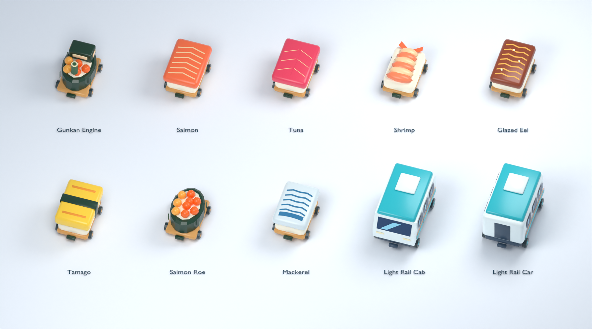

# Original Blender train assets

Ten independent cars were authored and exported with real Blender `bpy`, then
rendered in background mode with Cycles on the CPU. These are original geometry
and colors authored for this project, with no downloaded models, images, music,
or copied game assets. The contact sheet is a Blender asset render, **not a
screenshot of gameplay or proof of in-game lighting/performance**.



## Files and runtime contract

- [Authoring source](../../art_source/trains/train_assets.blend): the ten named
  mesh objects, arranged in an editing grid. The layout locations are for source
  browsing only; every independent GLB is exported at its own original origin.
- [Authoring program](../../tools/build_train_assets.py).
- [Runtime manifest](../../assets/trains/manifest.json): stable keys, `res://`
  file paths, actual bounds, triangle/vertex counts, material surfaces, file
  hashes and authoring source/generator hashes.
- [Direct exported-buffer acceptance](../../art_source/trains/asset-acceptance.json)
  and [validation program](../../art_source/trains/validate_assets.py).

The GLBs use meters, Godot +Y up and +Z forward; Blender source uses +Z up and
-Y forward. Each GLB has one identity-transform mesh node, XZ centered at the
origin, with the lowest point at Y=0. Runtime must use the **actual imported
bounds**, including wheels/couplers, for its separate per-car body and fit rule.
No collision, rigid body, route, train coupling or gameplay script is embedded
in the model. Each car is an individual asset, so the runtime can detach and
swallow one car without treating the full train as one food object.

`manifest.assets[]` contains `key`, `file`, `bounds.{min,max,size}`, `triangles`,
`vertices`, `materials`, `material_surfaces`, `bytes`, `sha256`, `forward`,
`base_y`, `source_object` and `semantic`. JSON vector order is X,Y,Z. The
manifest's dimensions and resource counts are measured, not nominal sizes.

| Key | Actual width × height × length (m) | Triangles | GLB bytes |
| --- | --- | ---: | ---: |
| `sushi_gunkan` | 1.026 × 1.220 × 1.570 | 1,228 | 80,456 |
| `sushi_salmon` | 1.026 × 0.818 × 1.570 | 892 | 50,836 |
| `sushi_tuna` | 1.026 × 0.828 × 1.570 | 872 | 49,944 |
| `sushi_shrimp` | 1.026 × 0.823 × 1.570 | 1,100 | 55,252 |
| `sushi_eel` | 1.026 × 0.822 × 1.570 | 972 | 53,804 |
| `sushi_tamago` | 1.026 × 0.896 × 1.570 | 1,064 | 59,792 |
| `sushi_roe` | 1.026 × 0.912 × 1.570 | 1,064 | 65,016 |
| `sushi_mackerel` | 1.026 × 0.811 × 1.570 | 892 | 50,840 |
| `rail_cab` | 1.252 × 1.343 × 2.150 | 804 | 54,960 |
| `rail_car` | 1.252 × 1.343 × 2.150 | 956 | 60,672 |

Total: **9,844 triangles** across all ten
assets, **581,572 GLB bytes**. Every car has exactly one opaque
vertex-color material surface, backface culling and no textures, skinning,
animation, lights or cameras. Gloss uses moderate roughness (0.32) and a small
clearcoat contribution; geometry, rounded edges and deliberate colors provide
readability without large texture assets. Dimensions include low-poly wheels,
so wheel polygon extrema are the exact grounded Y origin.

## Visual design

The gunkan engine has a seaweed shell, roe, an edible cab and a cut-cucumber
chimney. Salmon/tuna/eel/mackerel use distinct topping colors and authored
marbling or glaze lines. Shrimp uses curved segmented shell geometry and a
split tail; tamago has an omelette and seaweed belt; roe has separate rounded
egg geometry. Rice pillows have rounded edges and visible grain relief. Bamboo
underframes, wheels and couplers distinguish the set as an edible toy train.

The light rail shares the soft toy proportions, with a teal roof, cream body,
orange service stripe, separate windows, doors, wheels and couplers. The cab
has a sloping panoramic front window, painted sky reflection and headlights;
the passenger car has end gangways. Window/trim panels are authored colored
mesh faces rather than textures or additional material slots.

## Author validation

The final direct GLB parser passes **246 checks**. It verifies actual
binary accessor contents, valid indices and finite coordinates/colors/normals;
all triangles have positive area, face winding agrees with normals, and closed
solid components have outward signed volume. Decorative surface panels are
intentionally open and are not mislabeled watertight solids. Actual buffer
bounds match the manifest; all assets fit the size and 1,500-triangle budgets.
The source/generator SHA checks bind the receipt to the authored files.

The first asset check identified two thin decorative bevels that collapsed
into zero-area triangles. The bevel width now remains below half the shortest
box dimension; no geometric validation threshold was loosened. The final
contact sheet was inspected after correcting an initially embedded windshield
and enabling proper outward face winding with backface culling. Earlier failed
asset acceptance is preserved beside the final receipt.

The separate [non-author Godot resource/physics review](independent-review.md)
passes 388 checks, including actual imported colors, normals, geometry,
individual colliders and collection. It identified the disabled imported
vertex-color material flag; the runtime adapter now enables it while preserving
the authored finish. Neither set of checks establishes phone GPU cost, 60 FPS
or visual parity with another game.

## Reproduction and tool provenance

The installed Blender 5.2.2 and the official private 4.2.13 macOS build both
crashed in Metal device detection before executing Python in this environment.
Their original startup/crash logs are retained in `art_source/trains/`. The
working tool is a project-private **Blender 3.6.23 LTS** build with its OpenGL
background path; all modeling and rendering actually ran in that executable.

The macOS disk-image mount service was unavailable. The official image was
extracted as ordinary files with the official 7-Zip console utility, without
mounting a device, opening a window, changing installed user apps or preferences,
or launching Steam. The disk image SHA-256 matches the separately downloaded
[official Blender checksum](https://download.blender.org/release/Blender3.6/blender-3.6.23.sha256).
[Tool provenance](../../art_source/trains/toolchain-3.6.json) records exact
source URLs and hashes; the private binaries remain in `.build/blender-trains/`.
Only the project-owned assets, logs and source were written by the build.

```sh
.build/blender-trains/extracted-3.6/Blender/Blender.app/Contents/MacOS/Blender \
  --background --factory-startup --gpu-backend opengl --threads 4 \
  --python-exit-code 2 --python tools/build_train_assets.py
python3 art_source/trains/validate_assets.py
```

The generator has no randomness or time-based model parameters. Geometry,
keys, dimensions and material budgets are deterministic; the source `.blend`
is a native Blender serialization whose file hash is recorded for the current
artifact, not promised to remain identical across Blender versions/processes.
The authoring program does not save user preferences. Cycles renders only the
owned model scene; it does not capture the user's desktop or browser.
